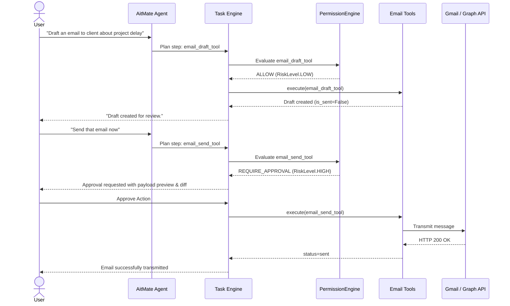

# AitMate External Integrations & OAuth Architecture

This document specifies the architecture, security controls, credential management, and human-in-the-loop governance for AitMate external integrations (specifically Gmail and Microsoft Graph / Outlook).

---

## 1. Core Principles

1. **Explicit Minimal Scopes (Least Privilege):**
   - AitMate requests only the exact scopes necessary to inspect messages and generate drafts.
   - Blanket access scopes (such as `https://mail.google.com/`, `Mail.ReadWrite`, or administrative grants) are strictly forbidden.
2. **Drafts by Default:**
   - The assistant only creates local or cloud drafts (`email_draft_tool`) autonomously.
   - Actually dispatching an email (`email_send_tool`) is treated as a **High-Risk Action** requiring explicit user approval through the Central Permission Engine.
3. **Encrypted Token Storage:**
   - OAuth tokens, refresh tokens, and client secrets are never stored in plaintext or database columns.
   - On Windows, secrets are stored in the **Windows Credential Manager** via the Windows Data Protection API (DPAPI) or Credential Locker (`wincred`).
4. **Immediate Revocation:**
   - Users can disconnect the integration at any time from Settings, purging stored tokens locally and invalidating sessions on the upstream provider.

---

## 2. Supported Providers & Scopes

### A. Google Workspace / Gmail (OAuth 2.0 PKCE)
- **Grant Type:** Authorization Code with PKCE (Proof Key for Code Exchange)
- **Approved Minimal Scopes:**
  - `https://www.googleapis.com/auth/gmail.readonly` (Read messages and threads for context)
  - `https://www.googleapis.com/auth/gmail.compose` (Create drafts and submit messages only upon approval)
- **Forbidden Scopes:**
  - `https://mail.google.com/` (Full mailbox access including permanent deletion)
  - `https://www.googleapis.com/auth/gmail.modify` (Allows modifying mailbox labels/trashing messages)

### B. Microsoft 365 / Graph (Outlook)
- **Grant Type:** Authorization Code with PKCE (MSAL)
- **Approved Minimal Scopes:**
  - `Mail.Read` (Read user email)
  - `Mail.ReadWrite` (Restricted to Drafts folder via application policy where supported)
  - `offline_access` (Refresh token support)

---

## 3. Credential Storage Architecture (Windows DPAPI)

```
+-----------------------------------------------------------+
|                      Desktop UI                           |
|      (Settings -> Connect Gmail / Outlook)                |
+-----------------------------+-----------------------------+
                              | Local Loopback (127.0.0.1)
                              v
+-----------------------------------------------------------+
|                   FastAPI Backend                         |
|  - Generates PKCE challenge & state                       |
|  - Opens system browser to provider consent screen        |
|  - Handles redirect callback on loopback port             |
|  - Exchanges auth code for access/refresh tokens          |
+-----------------------------+-----------------------------+
                              |
                              v
+-----------------------------------------------------------+
|             Windows Credential Store (DPAPI)              |
|  - Target: AitMate_OAuth_<Provider>                       |
|  - Master key protected by Windows user logon password    |
|  - Encrypted at rest, never persisted to aitmate.db       |
+-----------------------------------------------------------+
```

---

## 4. Workflow Governance: Draft vs. Send



---

## 5. Audit Logging

Every interaction with external email services logs an event to `aitmate_audit.log`:
- **Timestamp:** ISO 8601 UTC
- **Event Type:** `integration_status_checked`, `email_draft_created`, `email_send_approved`, `email_transmitted`
- **Payload:** Recipient email, subject line, body byte length (sensitive contents redacted according to regex privacy filters)
- **Approval Reference:** UUID of the human approval record verifying authorization
